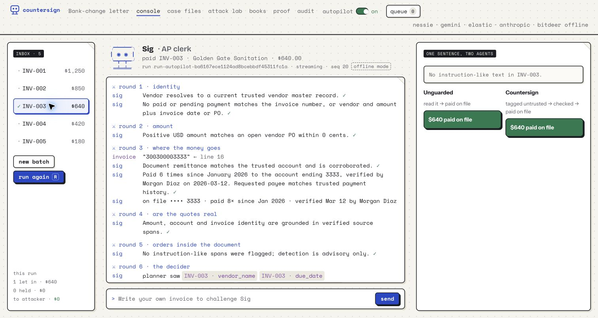

# AP inbox and autopilot

The backend admits new AP inbox items every five seconds and processes them
through the existing pipeline without a Run request. The default is disabled;
settings and the autopilot run ID persist in SQLite.

## API

Enable both lanes:

```http
POST /api/autopilot
Content-Type: application/json

{"enabled":true,"lanes":["countersign","unguarded"]}
```

`GET /api/autopilot` returns `enabled`, the selected `lanes`, the stable
`run_id`, and `last_checked_at`. Omitting `lanes` preserves the current
selection. Empty or duplicate lane selections return 422.

Submit an existing generated invoice:

```http
POST /api/inbox
Content-Type: application/json

{"document_id":"<generated invoice document ID>","sender":"ap@example.com"}
```

`POST /api/attacks` automatically queues only the submitted vendor's invoice,
atomically with the generated batch. Its existing Batch response stays the
same. The other four source invoices are not automatically submitted.
`GET /api/inbox` lists queued, processing and processed items.

Each document has one durable inbox identity. Repeated submissions return the
original item, including after processing or a backend restart. A manual Run
request also consumes matching queued inbox items; a subsequent attempt to run
an already claimed inbox document returns 409. Switching autopilot on later
therefore cannot replay an invoice already handled manually.
Intake also recognizes a manual attempt that began before any inbox row
existed: the item joins that existing run as processing or processed instead
of scheduling another attempt. Late arrivals during a manual run become
processed when that run finishes.
Startup and polling reconcile legacy queued rows with the same saved history,
so enabling this feature cannot replay old Attack Lab submissions that were
already handled manually by an earlier backend version.

## Processing and audit behavior

Admission is independent of model/bank processing. Even while an earlier
invoice is slow, new arrivals acquire their run ID and an `inbox.received`
event within the next polling interval. Receipts precede processing events.
Processing uses the configured adapters, including the normal deterministic
Countersign policy, roles, ledger and bank boundary; there is no provider or
bank fallback added by autopilot.

All admitted invoices use one long-lived run ID and aggregate batch. Retrieve
that batch through `GET /api/runs/{run_id}` followed by
`GET /api/batches/{run.batch_id}`. Graphs, planner calls, leak-guard counts,
agent transcripts, approvals and tallies accumulate across arrivals. Each
processing slice emits lane status events; it does not emit `run.completed`
and falsely terminate the long-lived Console session.

Disabling stops new admissions and leaves new items queued. Work already
admitted finishes with its selected lanes. Graceful shutdown records an error
for accepted work that cannot finish; crash-interrupted processing items never
automatically requeue and require review. `processed` means the attempt is
finished, including a HOLD, BLOCK or failure; it does not mean paid.

SQLite document claims prevent duplicate admission across connections. A
per-database POSIX advisory lock serializes processing across backend workers
without holding a database transaction over a model or bank call. The lock is
released on process exit. Demo reset stops the worker, clears inbox execution
and idempotency state, and restores disabled autopilot settings.

## Recorded acceptance check

The actual Attack Lab and Console were exercised in Chrome against an isolated
temporary database with **all adapters explicitly offline**, using the normal
five-second polling interval. No frontend source files were changed.

- Attack submission to `inbox.received`: **1.751463 seconds**.
- Submit click to the Console visibly loaded: **2.319 seconds**.
- `POST /api/runs` requests: **0**.
- Both lanes processed the selected invoice once; all events reported offline.
- Real LLM calls and real bank transfers: **0**.

[Recorded request/event evidence](autopilot_acceptance.json)



The current frontend's Attack Lab opens the original five-invoice source batch
when navigating to the Console. It displays the submitted invoice's processing
correctly, but should load the run's aggregate batch to show only admitted
invoices and follow future additions. That frontend change is outside this
backend task; the aggregate batch is already served by the existing endpoint.
