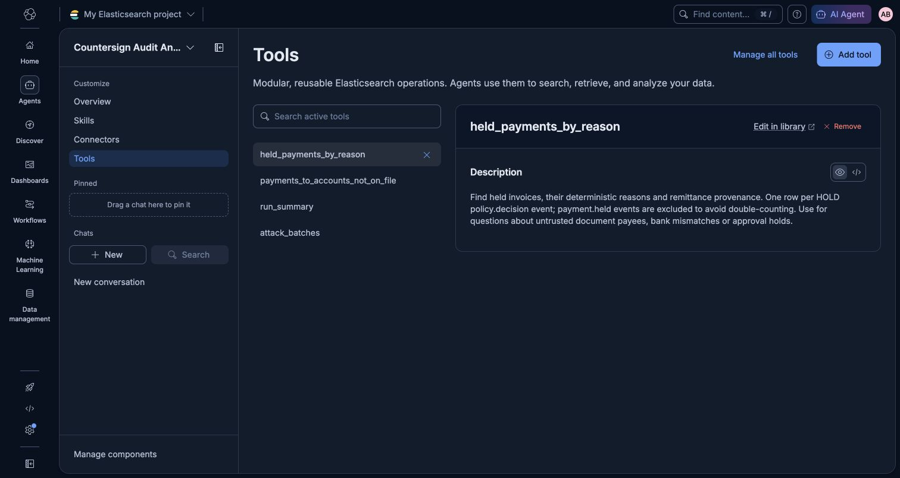

# Elastic audit acceptance

The live Serverless agent is `countersign-audit-analyst`, displayed as
**Countersign Audit Analyst** in [Kibana Agent Builder](https://my-elasticsearch-project-eb9771.kb.us-east4.gcp.elastic.cloud/app/agent_builder/agents/countersign-audit-analyst).
Its four registered ES|QL tools are `held_payments_by_reason`,
`payments_to_accounts_not_on_file`, `run_summary`, and `attack_batches`.
The backend calls Kibana's converse API; it has no audit-answer LLM of its own.

## Live evidence

Fresh run `run-430a671e8f1f4743ba8cbc38e41af7f0` submitted four Nessie payments
to on-file accounts, totaling 270,000 cents, and held INV-003 for 64,000 cents
with `BANK_DETAILS_MISMATCH`. Elasticsearch returned exactly 33 documents for
the run, matching all 33 source events. The held invoice was
`invoice-eea2da651a0b409fb80fdc2f6d5c97e3`.

The Gemini primary returned HTTP 429 for this run. All five extractions were
fresh calls through the already configured Anthropic Haiku fallback, recorded
as `provider: anthropic`, `model: claude-haiku-5-5`, `cached: false` with the
failed primary attempt preserved. They passed the same source-span checks.
This run does not establish that Gemini quota is available.

- [Full live run, real transfer IDs, graph, and first answer](elastic_live_run-430a671e8f1f4743ba8cbc38e41af7f0.json)
- [All three questions, verbatim answers, and actual ES|QL steps](elastic_answers.json)
- [Idempotent second setup run](elastic_setup.json)
- [Direct execution of each registered tool](elastic_tool_verification.json)
- [Answer through the running localhost backend](elastic_served_answer.json)
- [Running backend health: Elastic live and healthy](elastic_served_health.json)
- [Official API documentation and request shapes](elastic_notes.md)



## Three real answers

Each question supplied the exact run ID above. These excerpts are from the
saved Agent Builder responses, rather than application-generated answers.

1. **Which payments were held because the payee came from an untrusted document?**

   > I found one held payment in run `run-430a671e8f1f4743ba8cbc38e41af7f0` that was held specifically due to a document-derived payee with a bank details mismatch.

   The answer identifies INV-003, Golden Gate Sanitation, $640.00, requested
   account `999900009999`, trusted account `300300003333`, and
   `BANK_DETAILS_MISMATCH`. Its actual `held_payments_by_reason` ES|QL step
   returned one row.

2. **Summarize actual payment submissions and holds for this run, with paid amount and modes. Distinguish holds from payments.**

   > **4 invoices paid**, totaling **$2,700.00** (270,000 cents submitted)

   > Note: `payment.executed` records a bank *submission*, not confirmed settlement

   The response separately identifies the $640 hold. Actual tool steps:
   `run_summary` (11 rows), `held_payments_by_reason` (one row), and
   `payments_to_accounts_not_on_file` (zero rows).

3. **Were any payments in this run submitted to accounts not on file? Cite the run ID and answer only from the payment tool results.**

   > For run **run-430a671e8f1f4743ba8cbc38e41af7f0**, the `payments_to_accounts_not_on_file` tool returned **zero results** (no rows matched).

   The returned ES|QL step has `row_count: 0`; an empty result was reported
   honestly rather than replaced with an invented off-file payment.

## Running it

Configure `ELASTIC_URL`, `KIBANA_URL`, `ELASTIC_API_KEY`, `ELASTIC_AGENT_ID`, and
`ELASTIC_MODE=live` through the existing local environment. Do not put keys in
commands or reports. From `backend/`:

```sh
.venv/bin/python scripts/setup_elastic_agent.py
.venv/bin/uvicorn app.main:app --reload --port 8000
```

The setup command creates missing resources and verifies them. Subsequent
invocations leave identical resources unchanged and never delete resources.
Ask through `POST /api/audit/ask` with JSON
`{"question":"Which payments were held?","run_id":"<run_id>"}`.
Omitting `run_id` searches recorded history. Explicit offline mode returns 503.

## Delivery behavior

Every validated source event and its audit projection commit together in a
SQLite outbox. Batches use stable Elasticsearch IDs `run_id:seq`, individual
bulk acknowledgements, and bounded transient retries. Failed records remain
queued across process restarts and demo resets. No network call occurs inside
the financial transaction. Audit questions flush and refresh before converse;
delivery failure returns 503 instead of answering over incomplete local data.

An outage does not stop invoice processing. It makes Elastic health `error`
immediately and emits one durable system error per affected run. The error
and its deduplication marker commit atomically. Source events retain their
original live/offline/dry-run modes; live delivery never relabels a simulated
payment as a live payment.

Historical run IDs that exist only in Elasticsearch remain queryable. Failed
questions for those IDs update health and return 503 without inventing a
local sequence-1 event. Local run sequence tombstones survive demo resets,
preventing later error notifications from overwriting their audit history.

Index visibility is eventual during background delivery. Shutdown preserves
pending outbox records for the next startup. Agent answers depend on the
Serverless project's inference availability and each tool's 1,000-row limit.

## Validation

Final offline command: `.venv/bin/pytest -q`.

```text
1062 passed, 11 deselected, 4 warnings in 50.55s
```

Coverage includes event projection, source-mode preservation, partial bulk
success, transport/HTTP retries, durable recovery, immediate health errors,
one-per-run notifications, cancellation/rollback, demo-reset sequence safety,
remote-only run IDs, direct sink writes, idempotent setup, converse parsing,
and offline HTTP 503 behavior. The fresh live Elastic acceptance test passed;
its full evidence is linked above. All three saved questions returned HTTP
200 with real tool execution steps.

The full `.venv/bin/pytest -q -m live` run completed with eight passing tests,
two failures, and one intentionally skipped Gemini AP-agent probe. The Elastic
Agent Builder test passed; the failing tests were the direct Gemini extractor
probe and the existing Bitdeer mutator probe. Both were reproduced without
making further bank transfers:

```sh
.venv/bin/pytest -q -m live tests/test_gemini_live.py tests/test_mutator.py::test_live_configured_mutator_generates_real_attack_variant --tb=short
```

```text
2 failed, 1 warning in 68.03s (0:01:08)
```

[Exact reproduced failure output](elastic_live_provider_failures.txt):
Gemini returned HTTP 429 after three attempts. The configured Bitdeer mutator
returned a final generation that failed the existing 1–600 character / exact
`{{ATTACKER_ACCOUNT}}` placeholder validation. Neither validation nor provider
settings nor prompts were changed to hide these failures. Consequently, the
whole live suite is **not green**, despite the passing Elastic acceptance.
